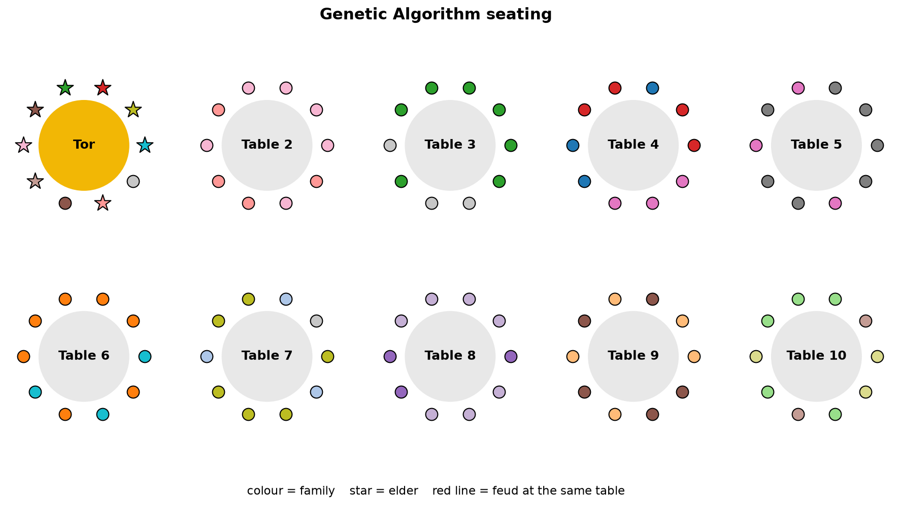
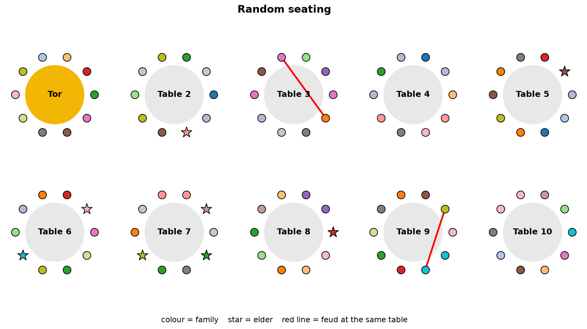
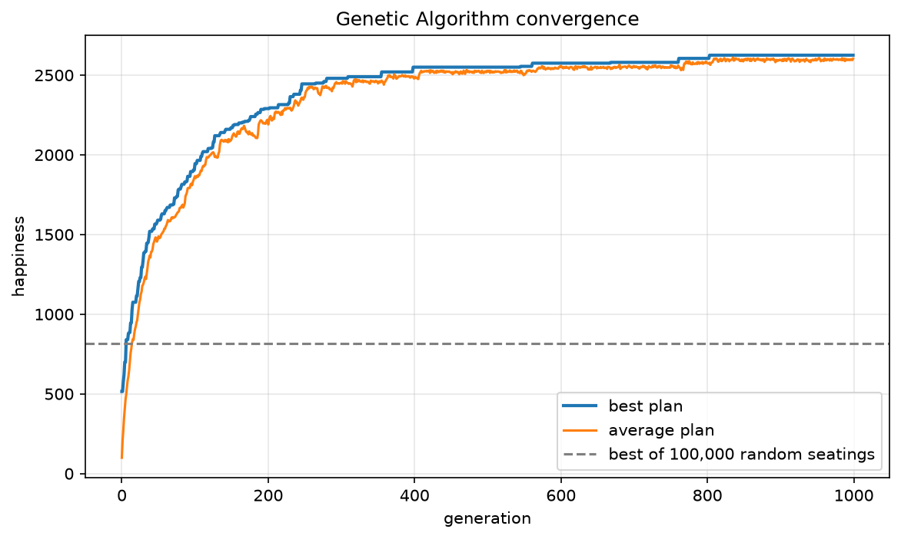

# ToiPlan 🎉: seating toi guests with a Genetic Algorithm

> 100 guests, 10 tables, 25 family feuds, and every elder expects a seat at the tör.

At a **toi** (a big Kyrgyz celebration) someone has to decide **who sits at which table**.
A good seating plan:

| Rule | Points |
|---|---|
| Relatives at the same table | **+10** per pair |
| Friends at the same table | **+5** per pair |
| People with a feud at the same table | **−100** per pair |
| Elder seated at the **tör** (table 1, the place of honour) | **+100** per elder |
| Every table has exactly 10 seats | always true (built into the encoding) |

There are about **10^92 possible seatings** (100! / (10!)^10), so trying all of them is impossible.
We use a **Genetic Algorithm (GA)** instead.

## How the algorithm works

1. **Encoding.** A seating plan is a list (permutation) of the 100 guest ids.
   Seats 1–10 are the tör, seats 11–20 are table 2, and so on, so every table always has exactly 10 guests.
2. **Fitness.** The "happiness" of a plan is the sum of the points in the table above.
3. **Population.** Start with 100 random seating plans.
4. **Selection (tournament).** Pick 3 random plans; the happiest one becomes a parent.
5. **Crossover (order crossover, 90%).** Copy a block of seats from parent 1 and fill
   the remaining seats with the other guests in the order they appear in parent 2.
6. **Mutation (30%).** Swap two random guests.
7. **Elitism.** The 2 best plans are copied unchanged into the next generation.
8. Repeat steps 4–7 for **1000 generations** and return the happiest plan.

As a baseline, we compare against **random search**: the best of 100,000 random seatings,
which is the same number of fitness evaluations the GA uses.

## Execution steps

**Requirements:** Python 3.10 or newer, and `git`.

1. **Get the code**
   ```bash
   git clone git@github.com:iamthefamous/presentation.git
   cd presentation
   ```

2. **Create and activate a virtual environment**
   ```bash
   python3 -m venv .venv
   source .venv/bin/activate          # Windows: .venv\Scripts\activate
   ```

3. **Install the dependencies** (numpy and matplotlib)
   ```bash
   pip install -r requirements.txt
   ```

4. **Run the planner**
   ```bash
   python toi_seating.py
   ```
   It takes about 10 seconds. Expected output (seed 42):
   ```
   100 guests, 19 families, 8 elders, 25 feuds
   possible seatings: ~10^92.4

   random_seating     {'happiness': -10, 'feuds_at_same_table': 2, 'elders_at_tor': 0, 'family_pairs_together_pct': 7.5, 'friend_pairs_together_pct': 5.0}
   best_random        {'happiness': 815, 'feuds_at_same_table': 0, 'elders_at_tor': 5, 'family_pairs_together_pct': 12.5, 'friend_pairs_together_pct': 7.5, 'seconds': 3.6}
   genetic_algorithm  {'happiness': 2625, 'feuds_at_same_table': 0, 'elders_at_tor': 8, 'family_pairs_together_pct': 75.8, 'friend_pairs_together_pct': 2.5, 'seconds': 6.1}

   saved results to .../results/
   ```
   The `seconds` values depend on your computer.

5. **Look at the results** in the `results/` folder:

   | File | What it is |
   |---|---|
   | `seating_plan.txt` | The final plan: every table with guest names |
   | `seating_ga.png` | Picture of the GA seating |
   | `seating_random.png` | Picture of a random seating, for comparison |
   | `convergence.png` | Best and average happiness per generation |
   | `summary.json` | All numbers, used for the presentation |

6. **(Optional) Experiment.** Change the settings at the top of `toi_seating.py`
   (`SEED`, `N_TABLES`, `N_FEUDS`, the points, `GENERATIONS`, `MUTATION_RATE`, …) and run step 4 again.

## Results

| | Random seating | Best of 100,000 random | **Genetic Algorithm** |
|---|---|---|---|
| Happiness | −10 | 815 | **2625** |
| Feuds at the same table | 2 | 0 | **0** |
| Elders at the tör | 0 / 8 | 5 / 8 | **8 / 8** |
| Relative pairs sitting together | 7.5% | 12.5% | **75.8%** |

The GA beats the best of 100,000 random seatings after only **6 generations**.





## Presentation

The slides are in [`ToiPlan.pptx`](ToiPlan.pptx).
